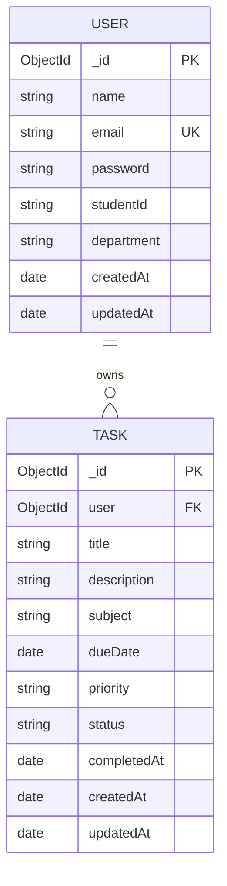

# Software Requirements Specification (SRS)
## Student Task and Deadline Management System

**Document Version:** 1.0  
**Date:** October 2026  
**Status:** Approved / Release Baseline  
**Project Type:** Full-Stack Web Application (MERN Stack)  

---

### Table of Contents
1. [Introduction](#1-introduction)
   - 1.1 Purpose
   - 1.2 Problem Statement
   - 1.3 Project Objectives
   - 1.4 Scope
   - 1.5 Intended Users & Personas
2. [Overall Description](#2-overall-description)
   - 2.1 Product Perspective
   - 2.2 System Architecture
   - 2.3 User Classes and Characteristics
   - 2.4 Operating Environment
   - 2.5 Design and Implementation Constraints
   - 2.6 Assumptions and Dependencies
3. [System Features & Functional Requirements](#3-system-features--functional-requirements)
   - 3.1 Student Authentication & Account Security
   - 3.2 Dynamic Student Dashboard
   - 3.3 Task and Assignment Lifecycle Management
   - 3.4 Advanced Search, Filtering, and Sorting
   - 3.5 Student Profile Management
4. [External Interface Requirements](#4-external-interface-requirements)
   - 4.1 User Interfaces (UI/UX)
   - 4.2 Hardware Interfaces
   - 4.3 Software Interfaces
   - 4.4 Communications & Network Interfaces
5. [Database Requirements](#5-database-requirements)
   - 5.1 Conceptual Data Model
   - 5.2 Schema Specifications (Users & Tasks)
   - 5.3 Data Integrity & Foreign Key Isolation
6. [Non-Functional Requirements](#6-non-functional-requirements)
   - 6.1 Performance Requirements
   - 6.2 Security Requirements
   - 6.3 Reliability & Availability
   - 6.4 Maintainability & Extensibility
   - 6.5 Usability & Accessibility
7. [Acceptance Criteria & Verification](#7-acceptance-criteria--verification)

---

### 1. Introduction

#### 1.1 Purpose
The purpose of this Software Requirements Specification (SRS) is to establish a definitive, unambiguous technical specification for the design, implementation, verification, and deployment of the **Student Task and Deadline Management System**. It specifies both functional behaviors and non-functional quality standards intended for students, academic evaluators, and system maintainers.

#### 1.2 Problem Statement
University students face high cognitive loads balancing overlapping coursework, lab assignments, capstone projects, and semester examinations across multiple subjects. Traditional methods of managing academic work—such as paper diaries, generic notes apps, or scattered communication channels—exhibit critical failure modes:
1. **Lack of Centralized Deadline Visibility:** Deadlines are forgotten or discovered last-minute, leading to penalized submissions and academic stress.
2. **Poor Priority Management:** Students struggle to distinguish between urgent near-term deadlines and high-weightage assignments.
3. **No Dynamic Workload Analytics:** Students lack visual feedback regarding what percentage of work has been finalized and which tasks are past due.
4. **Complexity of Enterprise Project Tools:** Commercial tools (e.g., Jira, Asana) are overly complex for individual student assignment workflows.

#### 1.3 Project Objectives
The objective is to deliver an accessible, reliable, single-page web application engineered specifically for student workflows:
- Enable students to record, modify, categorize, and track academic assignments.
- Calculate and visualize real-time completion percentages and overdue warnings.
- Provide multi-attribute filtering (by status, priority, and course subject).
- Enforce strict per-user database isolation ensuring student data privacy.
- Maintain a clean, responsive user experience optimized for desktop and mobile viewports.

#### 1.4 Scope
The system encompasses a client-side Single Page Application (SPA) built with React and Vite, communicating via RESTful JSON APIs with an Express.js/Node.js server connected to a MongoDB document database. The application provides authenticated student registration, session token handling, task CRUD operations, dashboard metric aggregation, and profile customization. Third-party institutional LMS integrations (e.g., Canvas, Moodle) are out of scope for this version baseline.

#### 1.5 Intended Users & Personas
- **Primary Persona:** Undergraduates and postgraduates managing concurrent course assignments, semester projects, and laboratory deliverables.
- **Secondary Persona:** Academic capstone evaluators and project supervisors reviewing code architecture, security practices, and documentation rigor.

---

### 2. Overall Description

#### 2.1 Product Perspective
The Student Task and Deadline Management System is an autonomous web application functioning within the modern MERN stack ecosystem. It separates presentation concerns (React client) from business logic (Express controllers) and persistent storage (MongoDB via Mongoose ODM).

```
+--------------------------------------------------------------------------+
|                           CLIENT TIER (React + Vite)                     |
|  - AuthContext & Axios Interceptors                                      |
|  - Views: Dashboard, Tasks List, Add/Edit Modals, Profile, Auth Pages    |
+--------------------------------------------------------------------------+
                                    │  ▲
             RESTful JSON over HTTP │  │ Bearer JWT
                                    ▼  │
+--------------------------------------------------------------------------+
|                           SERVER TIER (Node.js + Express)                |
|  - Auth Middleware (JWT Verification & Claim Extraction)                 |
|  - Controllers: AuthController, TaskController                           |
|  - Request Validation & Centralized Error Handler                        |
+--------------------------------------------------------------------------+
                                    │  ▲
              Mongoose Connection   │  │ Document Operations
                                    ▼  │
+--------------------------------------------------------------------------+
|                           DATABASE TIER (MongoDB)                        |
|  - 'users' Collection (Hashed credentials, student metadata)             |
|  - 'tasks' Collection (Indexed user foreign keys, due dates, statuses)  |
+--------------------------------------------------------------------------+
```

#### 2.2 System Architecture
1. **Frontend:** Client-side routing with `react-router-dom`, reactive state management with React Hooks and Context API, styled with utility-first Tailwind CSS.
2. **Backend:** Asynchronous Express REST API with modular controllers, centralized JSON error formatting, and stateless JWT authentication.
3. **Database:** Document-oriented MongoDB instance with Mongoose schemas, compound query indices, and schema-level validation hooks.

#### 2.3 User Classes and Characteristics
- **Standard Student User:** Can register an account, authenticate, create/edit/delete personal tasks, update profile details, and analyze dashboard statistics.
- **Unauthenticated Visitor:** Can access registration and login pages only. Access to task APIs without a valid cryptographic token is strictly denied (HTTP 401).

#### 2.4 Operating Environment
- **Client:** Modern web browsers (Google Chrome 110+, Mozilla Firefox 110+, Microsoft Edge 110+, Safari 16+) on desktop, tablet, and smartphone screens.
- **Server:** Node.js runtime (v18.x to v24.x) on Linux/Windows/macOS or cloud hosting environments (Render, Railway, AWS).
- **Database:** MongoDB 6.x or 7.x, either locally hosted or managed via MongoDB Atlas.

#### 2.5 Design and Implementation Constraints
- Passwords must never be stored in plaintext; one-way salted hashing via `bcryptjs` is mandatory.
- JSON Web Tokens must expire after a configurable duration (`JWT_EXPIRES_IN`).
- All task mutation requests must enforce ownership checks on the server to prevent horizontal privilege escalation.
- Zero mock or hardcoded student data in production builds.

#### 2.6 Assumptions and Dependencies
- Network connectivity exists between client browser and server API.
- MongoDB service is reachable via standard TCP connection string.
- System clocks on client and server are synchronized to ensure accurate overdue calculations.

---

### 3. System Features & Functional Requirements

#### 3.1 Student Authentication & Account Security
- **FR-AUTH-1:** The system shall allow new students to register with Full Name, Email, Password, Student ID, and Department.
- **FR-AUTH-2:** The system shall validate email syntax and reject duplicate registrations with HTTP 400.
- **FR-AUTH-3:** The system shall enforce a minimum password length of 6 characters.
- **FR-AUTH-4:** The system shall hash user passwords before persistence using bcrypt with a salt factor of 10.
- **FR-AUTH-5:** The system shall authenticate valid credentials and issue a signed JSON Web Token (JWT) containing the student's unique ID.
- **FR-AUTH-6:** The system shall allow authenticated students to retrieve their current profile information via `GET /api/auth/me`.
- **FR-AUTH-7:** The system shall provide secure logout by discarding tokens from client storage.

#### 3.2 Dynamic Student Dashboard
- **FR-DASH-1:** The dashboard shall calculate and render four key metrics: Total Tasks, Pending Tasks, Completed Tasks, and Overdue Tasks.
- **FR-DASH-2:** A task shall be classified as **Overdue** if and only if: `status == 'pending'` AND `dueDate < currentTime`.
- **FR-DASH-3:** The dashboard shall compute an overall completion rate percentage: `(completed / total) * 100`.
- **FR-DASH-4:** The dashboard shall render a high-visibility warning banner when `overdue > 0` with a direct shortcut to overdue items.
- **FR-DASH-5:** The dashboard shall display a priority breakdown showing the distribution of High, Medium, and Low priority tasks.
- **FR-DASH-6:** The dashboard shall render an **Upcoming Deadlines** panel displaying pending tasks due within the next 7 days, sorted chronologically.
- **FR-DASH-7:** The dashboard shall render a **Recent Tasks** feed displaying recently created or modified tasks.
- **FR-DASH-8:** The dashboard shall display an encouraging Empty State with a call-to-action button when a new student has zero tasks.

#### 3.3 Task and Assignment Lifecycle Management
- **FR-TASK-1:** Students shall create tasks specifying Title (mandatory, max 120 chars), Subject/Course (mandatory, max 80 chars), Due Date & Time (mandatory), Priority ('low', 'medium', 'high'), and Description (optional, max 1000 chars).
- **FR-TASK-2:** The system shall default newly created tasks to `status: 'pending'` and `priority: 'medium'`.
- **FR-TASK-3:** Students shall toggle tasks between `pending` and `completed` with a single click. When marked completed, `completedAt` timestamp is recorded.
- **FR-TASK-4:** Students shall edit existing task attributes via a pre-populated modal dialog.
- **FR-TASK-5:** The system shall require confirmation via an accessible modal dialog prior to deleting a task.
- **FR-TASK-6:** The server shall enforce that every task operation (`GET`, `PATCH`, `DELETE`) verifies `user: req.user._id`. Attempts to access another user's task ID shall return HTTP 404.

#### 3.4 Advanced Search, Filtering, and Sorting
- **FR-SRCH-1:** The system shall provide real-time keyword search across task title, course name, and description.
- **FR-SRCH-2:** The system shall allow filtering by status: All, Pending, Completed, and Overdue.
- **FR-SRCH-3:** The system shall allow filtering by priority: All, High, Medium, and Low.
- **FR-SRCH-4:** The system shall dynamically extract existing subjects from the student's task history and allow single-subject filtering.
- **FR-SRCH-5:** The system shall support sorting by Due Date (Ascending/Descending), Priority (High to Low / Low to High), and Creation Date.
- **FR-SRCH-6:** The system shall provide a single-click "Reset Filters" action returning the view to the default state.

#### 3.5 Student Profile Management
- **FR-PROF-1:** Students shall view their account details, registration timestamp, and semester productivity metrics.
- **FR-PROF-2:** Students shall update their displayed Name, Student ID / Roll Number, and Academic Department.
- **FR-PROF-3:** Email address shall remain non-editable as the primary account security identity.

---

### 4. External Interface Requirements

#### 4.1 User Interfaces
- **Design System:** Utility-first CSS using Tailwind with consistent typography (Inter font family), 8pt spacing grid, indigo primary palette, and accessible color contrast ratios (> 4.5:1).
- **Responsive Breakpoints:** Fully functional across Mobile (< 640px), Tablet (640px - 1024px), and Desktop (> 1024px).
- **Feedback Mechanisms:** Visual loading spinners, toast / alert banners for errors and successes, modal overlays with backdrop blur.

#### 4.2 Hardware Interfaces
- Operates over standard TCP/IP networking on desktop computers, laptops, tablets, and smartphones.

#### 4.3 Software Interfaces
- **Express.js API:** Exposes endpoints under `/api/auth` and `/api/tasks`.
- **Mongoose ODM:** Interfaces with MongoDB using connection pooling.

#### 4.4 Communications Interfaces
- Communication over HTTP/HTTPS with JSON request and response payloads.
- Bearer token authentication via HTTP `Authorization` request headers.

---

### 5. Database Requirements

#### 5.1 Conceptual Data Model
The database contains two core entities: `User` and `Task`, related via a one-to-many relationship (one student owns many tasks).



#### 5.2 Schema Specifications

##### `users` Collection
| Field | Type | Constraints | Description |
|---|---|---|---|
| `_id` | ObjectId | Primary Key, Auto | Unique document identifier |
| `name` | String | Required, Trim, 2-50 chars | Full student name |
| `email` | String | Required, Unique, Lowercase | Student email used for login |
| `password` | String | Required, Min 6 chars, Select: false | Hashed password string |
| `studentId` | String | Optional, Trim | College Roll No / Registration ID |
| `department` | String | Optional, Trim | Major or Department name |
| `createdAt` | Date | Timestamp | Account creation date |
| `updatedAt` | Date | Timestamp | Last account update date |

##### `tasks` Collection
| Field | Type | Constraints | Description |
|---|---|---|---|
| `_id` | ObjectId | Primary Key, Auto | Unique task identifier |
| `user` | ObjectId | Required, Ref: 'User', Index | Owner student foreign key |
| `title` | String | Required, Trim, Max 120 chars | Task or assignment title |
| `description` | String | Optional, Trim, Max 1000 chars | Additional guidelines / notes |
| `subject` | String | Required, Trim, Max 80 chars | Course or academic subject |
| `dueDate` | Date | Required | Submission deadline timestamp |
| `priority` | String | Enum: ['low', 'medium', 'high'] | Urgency indicator |
| `status` | String | Enum: ['pending', 'completed'] | Current lifecycle state |
| `completedAt` | Date | Default: null | Timestamp of task completion |
| `createdAt` | Date | Timestamp | Record creation date |
| `updatedAt` | Date | Timestamp | Record modification date |

#### 5.3 Compound Indices
- `{ user: 1, status: 1, dueDate: 1 }`: Optimizes dashboard metric calculations and task list filtering.
- `{ user: 1, priority: 1 }`: Optimizes priority sorting and filtering.
- `{ user: 1, subject: 1 }`: Optimizes course-specific queries.

---

### 6. Non-Functional Requirements

#### 6.1 Performance Requirements
- **API Response Time:** P95 response time under 150ms for authenticated task queries with standard payloads.
- **Client Load Time:** Initial Single Page App bundle loads and renders in under 1.5 seconds over standard broadband.

#### 6.2 Security Requirements
- **Cryptographic Hashing:** Passwords hashed with bcrypt (salt rounds = 10).
- **Stateless Session Tokens:** Signed with HMAC-SHA256 (JWT) and verified on each request.
- **Data Isolation:** User ID derived directly from verified JWT claims, never from client body parameters.
- **CORS Protection:** Configurable whitelist restricting browser access to designated client origins.
- **Error Information Leakage:** Production error handling suppresses stack traces, returning sanitized error messages.

#### 6.3 Reliability & Availability
- The system handles database disconnections gracefully, providing clear diagnostic logs.
- Unhandled Promise rejections are caught to prevent server process termination.

#### 6.4 Maintainability & Extensibility
- Clean separation of concerns (MVC architecture): Models, Controllers, Middleware, Routes, Client Views, Context.
- Reusable React components styled with atomic utility classes.

#### 6.5 Usability & Accessibility
- Forms include clear visual indicators for mandatory fields (`*`) and field-specific error messages.
- Destructive operations require modal confirmation to prevent accidental loss of academic data.
- High color contrast between text and background adhering to WCAG 2.1 AA standards.

---

### 7. Acceptance Criteria & Verification

| Requirement ID | Verification Method | Acceptance Standard |
|---|---|---|
| FR-AUTH-1 | Automated API Test | New user registers with HTTP 201 and receives valid JWT token. |
| FR-AUTH-2 | Automated API Test | Duplicate email registration attempt returns HTTP 400. |
| FR-TASK-1 | Automated API Test | Task created with title, subject, dueDate persists to MongoDB. |
| FR-TASK-6 | Security Isolation Test | User B querying or modifying User A's task receives HTTP 404. |
| FR-DASH-1 | Functional Test | Dashboard metrics match database counts for total, pending, completed, overdue. |
| FR-SRCH-1 | UI & API Test | Search query returns only tasks matching keyword in title/subject/description. |
| NFR-SEC-1 | Code Inspection | No plaintext passwords stored in database or exposed in JSON responses. |
